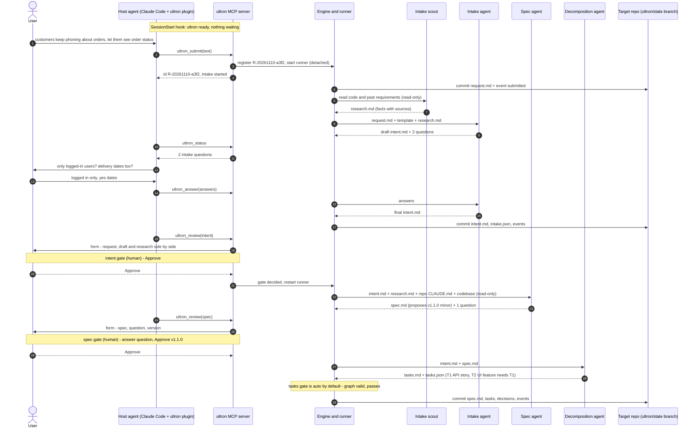
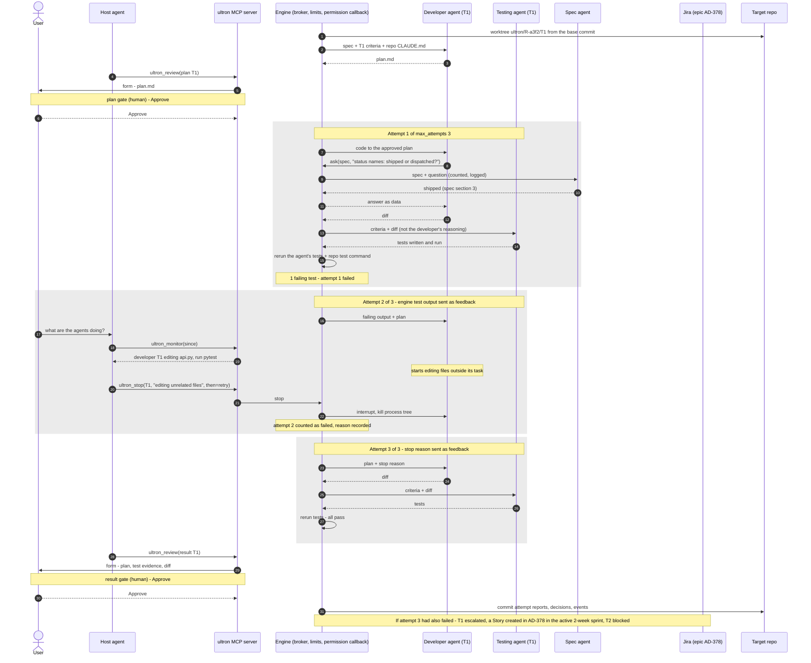
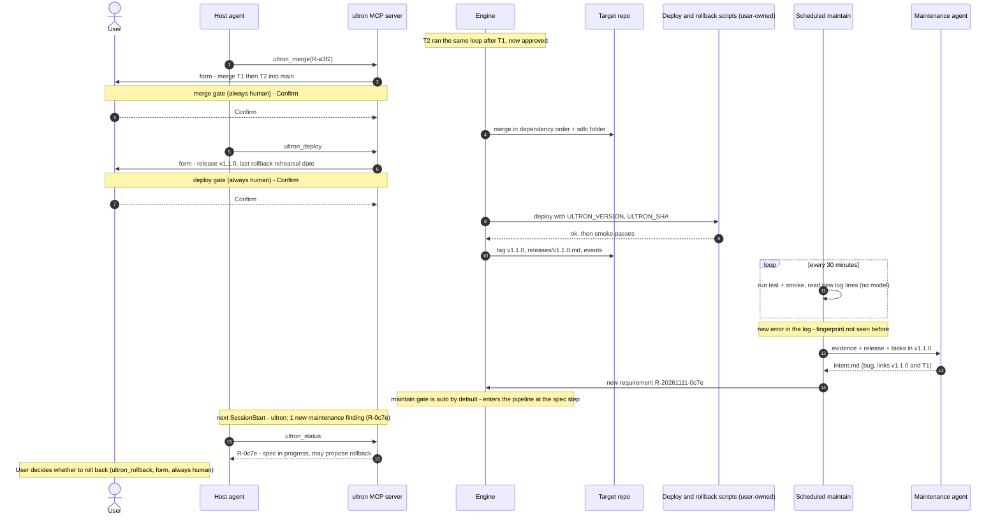

# Spec: ultron V0
Author: Claude (from `intent.md`), for adhyaanilkumar. Cycle: V0. Status: **approved (2026-11-10)**.
Date: 2026-11-09.

ultron is **not a standalone application**. It's **injected into coding agents**: an MCP server plus a package for each
host agent (a plugin with slash commands, a skill and a guard hook). The user works inside the coding agent they
already use, which is Claude Code in V0:
1. The user describes a requirement in the host agent.
2. the ultron agents (ultron's own agents) turn it into a spec, tasks and plans, then code and test each task.
3. The human approves at the gates through forms in the host agent, and merges and deploys.
4. After a release, a maintenance check turns new failures into new requirements.

An evaluation harness measures how often this works on real, closed GitHub issues.

---

## 1. Decisions

**Confirmed** means the owner decided it on 2026-11-09. **Proposed** means Claude recommends it and the owner should
confirm or change it during this review.

| # | Decision | Status |
|---|---|---|
| D1 | Language: **Python**. | Confirmed |
| D2 | **ultron is injected into coding agents, not a standalone app.** Its core is an MCP server, packaged for each host agent with a plugin, slash commands, a skill and a guard hook. V0 targets Claude Code, and other hosts (Codex first) are later packages. Every user-facing action is a tool or slash command inside the host. The only executables outside the host are background processes the user never opens directly: the runner, scheduled maintenance, and the terminal-only approval fallback (§5). | Confirmed (2026-11-09) |
| D3 | **ultron agents are ultron's choice, made in config.** ultron runs its own agents, called **ultron agents** (intake, spec, decomposition, developer, testing, maintenance) behind one `AgentRunner` interface. The V0 adapter is **Anthropic's Claude Agent SDK** (Python) on the user's Claude subscription. `claude -p` is the fallback adapter if the SDK can't use the subscription. Codex and other agents are later adapters, chosen per role in `ultron.toml` (§11). | Confirmed (2026-11-09) |
| D4 | Terms: **requirement** = one `intent.md` and everything derived from it; **task** = one unit of work split from a requirement; **ticket** = only a Jira issue. Where the intent says "ticket" (§6, §8), this spec says "requirement". | Confirmed |
| D5 | Failed tasks become **Jira tickets** under the target repo's epic, as a Story, Feature or Bug, in the board's current **2-week sprint** (§12). ultron never creates sprints (changed from Mon–Fri on 2026-11-10). This replaces the intent's CLI or web escalation board. Intake stays local, never through Jira, so intent §7 still holds. | Confirmed (Jira); details proposed |
| D6 | **Hybrid intake.** The user writes a template `intent.md` or just describes the need. Free text goes to the intake agent, and the draft is approved at the `intent` gate (§7.1). | Confirmed |
| D7 | **The user chooses** which approvals are human or automatic, and the dev→test attempt limit (`max_attempts`, default 3). `merge` and `deploy` are always human (§8). | Confirmed (feature); defaults, range and locks proposed |
| D8 | **Approvals come from the human, never the model.** The preferred channel is an MCP **elicitation** form that the host shows to the human. The model can't fill it in. The fallback is the `ultron gate` command, which needs an interactive terminal and typed confirmation. The guard hook also blocks the host model from running it (§8). | Confirmed (2026-11-10, spec approval) |
| D9 | **Long work runs outside the MCP call.** Tools return immediately. A detached `ultron run` process advances a requirement until it needs a human, then stops. Closing the host agent doesn't stop work in progress (§9). | Confirmed (2026-11-10, spec approval) |
| D10 | **State is an append-only event log committed to git.** SQLite is a local cache rebuilt from it. V0 is single-user, and team sync is in the backlog (§10). | Confirmed |
| D11 | ultron commits each requirement's artifacts and event log to an `ultron/state` branch in the target repo. `ultron_merge` brings the requirement's folder into the target branch with its code. | Confirmed (2026-11-10, spec approval) |
| D12 | ultron **proposes each release's version** from the intent: major, minor or patch, as in social-grid. A person confirms it at the spec gate (§13). | Confirmed |
| D13 | ultron checks that the user is **signed in to a Claude Code account** before any ultron agent runs (§14). | Confirmed |
| D14 | Look: the owner's Ultron pixel-art mascot in gunmetal with `#941212` eyes, a crimson `#E5484D` wordmark, and the owner's palette (§18). | Confirmed |
| D15 | Evaluation: **SWE-bench Verified, sympy (75) and pytest (19)**, with a **5-requirement pilot** first. Evaluation runs don't create Jira tickets unless asked (§16). | Confirmed (2026-11-10, spec approval) |
| D16 | Model and effort per role, pinned in `ultron.toml` and overridable: intake scout Haiku 5.5 medium; intake agent Sonnet 5.5 medium; spec (architect) and decomposition agents Opus 5.5 high; maintenance agent Sonnet 5.5 medium. The developer and testing agents run at their task's **rung** (D25) (§11.4). | Confirmed (2026-11-10) |
| D17 | **ultron agents talk only through the engine (a broker).** No ultron agent contacts another directly. An ultron agent asks a question with a broker tool, and the engine records it, applies limits, routes it to the right role (any adapter), or asks the human. Agent-facing tools are an agent-neutral MCP interface, so Codex-based ultron agents can use them too (§11.2). | Confirmed (2026-11-09) |
| D18 | **Direct peer-to-peer messaging between agents (e.g. the A2A protocol) is a backup**, kept in `sdlc/backlog.md` and used only if brokered messaging proves too limiting. | Confirmed (2026-11-09) |
| D19 | **V0 is single-user.** One person plays every human role (requester, architect, developer, tester) on their own machine. Team features (team sync, separate people per role, permissions, the multi-project registry) are in `sdlc/backlog.md`. | Confirmed (2026-11-09) |
| D20 | **The host agent monitors and can stop ultron agents.** It sees which ultron agents are running, what each is doing step by step, its progress and its usage. If one goes out of line, the host can **stop** it, and then retry, hold, or escalate the task to Jira. The engine also stops agents automatically on clear violations. Stopping can only end or pause work, never advance it (§9.1). | Confirmed (2026-11-09) |
| D21 | **The host learns ultron's state when a session starts.** The plugin's SessionStart hook reads ultron's cache, with no model involved, and adds a one-line summary to the new session: items waiting on the user, running ultron agents, new escalations (§9.1). | Confirmed (2026-11-10) |
| D22 | **ultron agents get context built by the engine, per role** (§11.3). That includes the target repo's `CLAUDE.md` and `AGENTS.md`, passed **as data** (conventions to follow unless they conflict with ultron's rules), never as settings. Repo hooks, permissions and MCP servers are still never loaded. It's on by default for repos set up with `/ultron:init`, and off in evaluation runs. | Confirmed (2026-11-10) |
| D23 | **Research-assisted intake: one read-only intake scout.** Before the intake agent drafts, a scout reads the target codebase and the repo's past requirements (no web, no shell, no Jira in V0) and writes facts with sources to `research.md`. The intake agent uses it only to ask sharper questions, fill "Affected users and systems" and flag possible duplicates. Problem and Proposed outcome stay in the user's words. Switch: `intake_research = "off" \| "local"`, default `local`, forced off in evaluation runs (§7.1). Researched 2026-11-10. | Confirmed (2026-11-10) |
| D24 | **ultron uses deployment and maintenance infrastructure but never builds it on its own.** It uses them through a small contract in `ultron.toml` (§10.1): only `test` is required, and `deploy` and `rollback` are optional but come as a pair. If a repo needs infrastructure built, that's an ordinary requirement through the pipeline, with a human-steps checklist and a cost table (§7.3). Accounts, credentials, payments and provisioning are always done by the human. Researched 2026-11-10. | Confirmed (2026-11-10) |
| D25 | **Model and effort per task, raised on failure.** The decomposition agent scores each task's complexity with a fixed rubric and picks a starting **rung** (a model plus effort level, from Haiku 5.5 medium up to Opus 5.5 max). Every counted failed attempt moves the task up one rung. Fable is never used unless the owner approves its cost for a requirement (§11.4). Researched 2026-11-10. | Confirmed (2026-11-10, spec approval) |
| D26 | **ultron is distributed, not hosted.** Each user runs their own copy locally: Claude Code starts the MCP server over stdio, with the user's own Claude login. The ultron GitHub repo is also a Claude Code plugin marketplace, and the plugin runs a pinned release through `uvx`. A version tag triggers a GitHub Actions release. A hosted HTTP MCP server is in the backlog (§5.3). | Confirmed (2026-11-10) |
| D27 | **Short tickets and `call_for_edit`.** A ticket's description stays within 280 characters unless more is required; details go in an attached report, because people get overwhelmed reading AI content. Before filing, the engine checks every attachment exists; a missing one sends the task to `call_for_edit`, where the task's developer agent adds it. After filing, the user can also send an escalated task to `call_for_edit` when the assigned developer needs more context or has questions (§3, §12). | Confirmed (2026-11-11, owner) |
| D28 | **Request changes at the intent gate.** Like spec and plan, the intent gate offers Request changes as well as Approve; changes send the draft back to the intake agent with the comment (§3). | Confirmed (2026-11-11, owner) |
| D29 | **`call_for_edit` edge cases.** (1) Stopping the agent in `call_for_edit` returns the task to the state it came from; nothing counts as an attempt. (2) Every escalation, whatever its reason (failure, rejection, stop, cap), runs the attachment check first. (3) If the spending cap is reached during `call_for_edit`, the ticket is filed without the missing file and says which is missing. (4) If a file is still missing after the edit, one more `call_for_edit` round runs; if it is still missing, the ticket is filed noting it (§3, §12). | Confirmed (2026-11-11, owner) |

Features for later versions are in `sdlc/backlog.md`: the web page, team sync, other host agents and ultron agents
(Codex first), direct peer-to-peer messaging, the registry, and the eval reviewer agent.

---

## 2. How it's used inside Claude Code (V0)

```
you    > /ultron:init                                   (once per repo: ultron_init sets the repo up)
you    > customers keep phoning to ask where their order is, let them see it in the app
claude   (calls ultron_submit)  ultron's intake agent has 2 questions: only logged-in users? delivery dates too?
you    > logged in only, yes dates
claude   (calls ultron_answer)  The draft intent R-20261109-a3f2 is ready.
         ┌ ultron · approve intent R-20261109-a3f2? ─────────── [Approve] [Request changes] ┐  ← elicitation form,
         └ comment: ________________________________________________________________________┘    answered only by you
...later...
you    > /ultron:status
claude   (calls ultron_status)  The spec is ready (it proposes v1.1.0, a minor bump), and 2 plans are waiting.
you    > show me the spec, then let me review it
claude   (calls ultron_show, then ultron_review)  → form: Approve / Request changes / Reject, version, comment
...
you    > merge it and deploy
claude   (calls ultron_merge, ultron_deploy)  → a confirmation form for each, always answered by you
```

ultron agents run in the background between these steps. Closing Claude Code doesn't stop them.

---

## 2a. One end-to-end flow (sequence diagrams)

**Example:** a single requirement on a sample web app, from the user's words to a deployed release, and then to a
regression that maintain catches. Everything is set to its defaults. The three diagrams continue one another. The
human decides only at the forms (shown as notes).

### Part 1: from the user's words to an approved spec and tasks



### Part 2: one task through plan, attempts, monitoring, a stop, and the result gate



### Part 3: merge, deploy, and maintain catching a regression



---

## 3. Actors and lifecycle

| Actor | Type | In ultron |
|---|---|---|
| Requester | Human | Describes the need or supplies `intent.md`, and approves an intake draft |
| Intake scout | ultron agent | Reads the codebase and past requirements, read-only, and writes facts with sources to `research.md`. It proposes nothing. |
| Intake agent | ultron agent | Turns free text into `intent.md` and asks up to 5 clarifying questions. It adds no scope and has no tools. |
| Spec agent | ultron agent | Writes `spec.md` and proposes the version bump |
| Architect | Human | The `spec` gate |
| Decomposition agent | ultron agent | Writes `tasks.md` and `tasks.json` (the dependency graph) |
| Developer agent | ultron agent, one per task | Writes `plan.md`, then changes code following the approved plan |
| Testing agent | ultron agent, one per task | Writes and runs tests against the acceptance criteria |
| Developer | Human | The `plan` gate |
| Tester | Human | The `result` gate |
| Developers | Human | Work the escalated Jira tickets |
| Maintenance agent | ultron agent | Diagnoses a detected failure and writes `intent.md`. It never edits code or deploys. |
| The host agent and its model (Claude Code in V0) | Host | Calls ultron's tools for the human. **It never decides a gate.** |

In V0 every human role above is **the same single user** (D19). The roles are still recorded separately, by gate,
so that adding real teams later doesn't change the event log.

**Requirement states** (only the engine changes them):
`submitted → [intake_drafting → awaiting_intent → (changes → intake_drafting)*] → spec_drafting → awaiting_spec → (changes → spec_drafting)* →
spec_approved → decomposing → [awaiting_tasks] → in_progress → complete | partial | escalated`.
The bracketed steps happen only when they apply.

**Task states:**
`pending (deps unmet) → planning → awaiting_plan → (changes → planning)* → plan_approved → attempt k (coding →
testing) → passed → awaiting_result → approved | rejected`, plus `failed` after `max_attempts` attempts.
`rejected` and `failed` lead to `escalated` automatically (the engine, not a gate). On the way, the engine checks the ticket's attachments: if any is missing the task goes to **`call_for_edit`**, where the task's developer agent (same rung, not an attempt, never touching code) adds it, and the task then becomes `escalated` (D27). After filing, the user can also send an `escalated` task to `call_for_edit` with a question when the assigned developer needs more context; the agent's answer is attached to the ticket and the task returns to `escalated`. Edge cases (D29): a stop in `call_for_edit` returns the task to where it came from; every escalation reason runs the attachment check; at the spending cap, or when a file is still missing after a second round, the ticket is filed noting the missing file. A stopped ultron agent leads to `held`, the next attempt, or
`escalated` (§9.1). A task whose dependency is escalated becomes `blocked` and is never
merged on its own.

---

## 4. Functional requirements

**Setup**
- **FR1** `/ultron:init` (the `ultron_init` tool) prepares the repo open in the host agent:
  - writes `ultron.toml`, after detecting the contract's commands (§10.1) from the Makefile, `package.json`,
    `pyproject.toml` or existing CI. It asks only about what it can't find, leaves `deploy` blank by default, and
    never creates infrastructure;
  - gitignores `.ultron/`;
  - creates the `ultron/state` branch;
  - offers to register scheduled maintenance (§15).

  Installing the plugin registers the MCP server with the host. No separate install step is needed.

**Intake and spec**
- **FR2** `ultron_submit` takes a template `intent.md` (a path or its text) or free text (§7.1). It returns the new
  requirement id at once.
- **FR3** The spec agent reads the intent and the target codebase (read-only) and writes `spec.md`. The spec has
  requirements, design, acceptance criteria, flagged concerns, and a proposed version bump with its reason.
- **FR3a** The spec agent may raise **questions for the user** in `spec.md` (gaps that only appear once the code is
  read, as the playbook's Stage 2 expects). They're listed at the `spec` gate, and the user's answers go back to the
  spec agent with any change request.
- **FR4** At the `spec` gate the user approves (optionally changing the version) or requests changes with comments.
  When changes are requested, the spec agent runs again. Nothing downstream starts before approval.

**Tasks and plans**
- **FR5** The decomposition agent writes `tasks.md` and `tasks.json`. Each task has id, title, description,
  acceptance criteria, `depends_on`, `ships_independently`, and a `type`: `story`, `feature` or `bug`. The type
  sets the Jira issue type if the task is escalated. Tasks of a maintenance requirement default to `bug`. Each task
  also gets a complexity score, its reasons and a starting **rung** (§11.4). The engine rejects a cycle in the graph or an unknown
  dependency and reruns the agent, once.
- **FR6** Tasks whose dependencies are all approved run in parallel (`max_parallel`, default 2), each in its own git
  worktree and branch. A dependent task starts from its dependencies' approved work, merged in by the engine (never
  by an agent).
- **FR7** The developer agent writes `plan.md` (files that change, order of work, risks, proof). No code is written
  before the `plan` gate approves it.

**Attempts** (the engine enforces all of these)
- **FR8** One attempt has three steps:
  1. The developer agent codes to the approved plan.
  2. The testing agent writes tests for the acceptance criteria and runs them.
  3. The engine reruns those tests plus the repo's own test command and decides pass or fail from the real exit codes.
- **FR9** If an attempt fails, the engine's test output goes back to the developer agent. A revised plan goes back
  through the `plan` gate, and the attempt count is kept.
- **FR10** A task has at most `max_attempts` attempts:
  - the user chooses the number: default 3, range 1–10, set per repo or per requirement;
  - it's fixed for each task when the task is created;
  - time waiting at a gate isn't an attempt.
- **FR10a** Each counted failed attempt runs the next attempt **one rung higher** (§11.4), up to the cap. The engine,
  not an agent, sets the model and effort for every call, and logs what actually ran.
- **FR11** If a developer agent's diff changes a test file the testing agent wrote, that attempt fails.

**Result, escalation, merge and deploy**
- **FR12** At the `result` gate the user sees the plan, the test evidence and the diff, then approves or rejects.
- **FR13** A task that fails `max_attempts` times, or is rejected, is escalated to Jira (§12).
- **FR14** `ultron_merge` (always human-confirmed) merges approved task branches into the target branch in dependency
  order, together with the requirement's `sdlc/` folder. It skips tasks with an escalated dependency and stops on a
  conflict.
- **FR15** `ultron_deploy` (always human-confirmed) records the release (version, commit, time, who, requirements
  and tasks) and tags it.
  - **If `deploy` is configured,** it runs the deploy script with `ULTRON_VERSION`, `ULTRON_SHA` and `ULTRON_ENV`, then
    runs `smoke`.
  - **If `deploy` isn't configured,** it only records a release marker. Nothing runs, and maintain checks that commit.
  - **Rollback rehearsal:** the form shows when a rollback was last rehearsed (`rollback_rehearsed_at`). If that's
    older than `rollback_rehearsal_days` (default 30), the form asks the user to rehearse and confirm first.
- **FR15a** `ultron_rollback` (always human-confirmed, locked) runs the `rollback` command with the previous
  release's commit, then `smoke`, and records it. Maintain may propose a rollback in an intent, but never runs one.

**Records, caps and status**
- **FR16** Every gate decision is an event: who (the git identity, or `auto`), when, the channel (form or terminal fallback), the
  decision and the comments. `decisions.md` is generated from the events.
- **FR17** Every ultron agent call is logged: role, requirement, task, attempt, prompt, result, duration, tokens and an
  API-equivalent cost estimate. The full transcript is kept locally, and a summary goes in the event log.
- **FR18** Spending caps (API-equivalent USD) apply per requirement and per evaluation run. The engine checks the
  total before each ultron agent call. If a requirement hits its cap, its unfinished tasks are escalated.
- **FR19** `ultron_status` shows requirements, tasks, states, attempts (`2/3`) and what's waiting on the user.
- **FR19a** `ultron_monitor` shows live ultron agent activity (§9.1).
- **FR19b** `ultron_stop` ends a running ultron agent, then retries, holds or escalates its task (§9.1). The engine
  also stops agents automatically on clear violations.

**Maintain**
- **FR20** A scheduled `ultron maintain` checks the released version and files linked intents for new failures (§15).

---

## 5. Architecture

```
 host coding agent (Claude Code in V0) ── ultron plugin: MCP registration · /ultron:* commands · skill · guard hook
        │  MCP (stdio)                      elicitation forms are shown to the human by the host
        ▼
 ultron MCP server ── host tools (§6) ── engine (state machine, gates, attempt limit, caps)  ← the authority
                                            │ writes events + artifacts (one commit per step)
                                            ▼
                                  target repo: ultron/state branch (event log, sdlc/ artifacts)
 background processes (started by ultron, never opened by the user):
   ultron run <requirement> ── advances until a human is needed, then exits
        ├─ AgentRunner ── Claude Agent SDK adapter (V0) · later: Codex and others ── ultron agents in their own worktrees
        └─ broker ◀── agent tools (ask / report), agent-neutral MCP (§11.2)
   ultron maintain ── scheduled checks (§15)
   ultron gate ── terminal-only approval fallback (§8)
```

### 5.1 Components
| Component | Job |
|---|---|
| `mcp/` | The MCP server: host tools, elicitation forms, and resource links to artifacts |
| `engine/` | States, gates, attempt limits, caps, dependency order. It's the only thing that changes state. |
| `runner/` | `ultron run`: a detached runner process per requirement, with a lock, resume and scheduling of parallel tasks |
| `agents/` | The `AgentRunner` interface, the Agent SDK adapter, the `claude -p` fallback adapter, prompts per role and output schemas |
| `broker/` | Agent-to-agent messaging through the engine, and the agent-facing MCP tools (§11.2) |
| `store/` | The event log (source of truth), the SQLite cache and the artifact writer |
| `git/` | Worktrees, branches, merges and diffs |
| `intake/` | The template check, the intake scout and the intake flow |
| `jira/` | The escalation client |
| `maintain/` | Checks, the log reader, fingerprints and the intent writer |
| `eval/` | Dataset prep, runs, grading and the report |
| `hosts/claude-code/` | The Claude Code plugin (§5.2) |
| `bin/` | The background entry points: `run`, `maintain` and the `gate` fallback. None of them is a user-facing app. |

### 5.2 Host packaging: the Claude Code plugin (V0)
This is how ultron is injected into Claude Code. Installing the plugin is the whole setup.

| Part | What it does |
|---|---|
| MCP registration | Starts the ultron MCP server when Claude Code starts |
| Slash commands | `/ultron:init`, `/ultron:status`, `/ultron:submit`, `/ultron:review`, `/ultron:monitor`, `/ultron:stop`, `/ultron:doctor`, `/ultron:eval` |
| Skill | Teaches the host model how ultron works: the requirement lifecycle, what each gate means, and that **only the human approves** (through the form, or by running the fallback command themselves) |
| Guard hook | A PreToolUse hook that blocks the host model's own shell calls to `ultron gate`, the `bin/` entry points, and git operations on `ultron/state`. The block message tells the model to ask the human. |
| SessionStart hook | When a Claude Code session starts, it reads ultron's cache (fast, no model) and adds one line of context, e.g. *"ultron: 2 plans waiting for your review · 1 ultron agent running (R-…a3f2/T2, attempt 2/3) · 1 new escalation (AD-391)"*. If ultron isn't set up for the repo, it adds nothing. |

**Other hosts later.** Codex is first (backlog): the same MCP server, registered through Codex's MCP config, plus
Codex's own way of giving instructions in place of the skill. The core never changes per host. Only the package does.

---

### 5.3 Distribution and releases (D26)
**ultron runs on each user's own machine.** There's no ultron server to host.
- Claude Code starts ultron's MCP server as a local process and talks to it over **stdio**. The detached runner
  (§9) is a local process too.
- Each user runs their own copy, with **their own Claude login** and their own repos. Anyone can install it, but
  people don't share one running instance (that's team sync, in the backlog).
- **Cost: ₹0.** No hosting, no domain, no server login.

**How a user installs it:**
1. In Claude Code: `/plugin marketplace add <owner>/ultron`, then `/plugin install ultron`. The ultron repo carries
   `.claude-plugin/marketplace.json` and the plugin folder, so the repo itself is the marketplace.
2. The plugin's MCP config starts the server with
   `uvx --from git+https://github.com/<owner>/ultron@v<version> ultron mcp`. `uv` fetches that exact tagged release
   and its locked dependencies, so there's no separate Python install step beyond having `uv`.
3. `/ultron:doctor` checks the rest (§14), then `/ultron:init` sets up a target repo.

**How a release is made:**
- ultron's own versions follow the same rule it applies to target repos (§13) and go through the playbook stages.
- Pushing a tag `v<version>` runs a GitHub Actions workflow: `make build`, `make lint`, `make test`, then a GitHub
  release with notes from `sdlc/v<version>/`. The plugin's pinned version is bumped in the same release commit.
- Merging to `main` stays human, through a PR. GitHub Actions is free for public repos, so this costs ₹0.
- Publishing to PyPI comes later, once the package is stable.

**Updating:** the user runs `/plugin update ultron`. A new release never changes in-flight requirements: each event
records the ultron version that wrote it, and a newer ultron reads older event logs.

**Not in V0:** a hosted HTTP MCP server that hosts connect to by URL. It would need a server, a domain, user login
and monthly hosting (backlog).

## 6. MCP tools

| Tool | Does | Human-only? |
|---|---|---|
| `ultron_init` | Prepares the open repo (FR1) | No |
| `ultron_doctor` | Runs the Claude Code connection and setup checks (§14) | No (read) |
| `ultron_submit` | Starts a requirement from a file or text, and returns its id | No |
| `ultron_answer` | Passes the user's answers to the intake agent's questions | No |
| `ultron_status` | Requirements, tasks, states, and what's waiting on the user | No (read) |
| `ultron_show` | Any artifact: request, intent, spec, tasks, a plan, a diff, test evidence, an attempt log, decisions | No (read) |
| `ultron_explain` | Why an attempt failed or a task was escalated, from the engine's records | No (read) |
| `ultron_monitor` | Live ultron agent activity: who is running, their recent steps, progress and usage. It can follow from a cursor, or show one ultron agent's recent transcript (§9.1). | No (read) |
| `ultron_stop` | Ends a running ultron agent with a reason, then `retry`, `hold` or `escalate` the task (§9.1) | No, because it can only end or pause work, never advance it |
| `ultron_call_for_edit` | Sends an `escalated` task to `call_for_edit` with the user's question; the task's developer agent answers and the answer is attached to its ticket (D27) | **Human-confirmed** through a form |
| `ultron_resume_task` | Resumes a `held` task from where it stopped, with an optional note from the user as feedback | **Human-confirmed** through a form, because it restarts work the host or engine stopped |
| `ultron_settings` | The gate settings and `max_attempts` in force | No (read) |
| `ultron_review` | Opens the review form for something waiting at a gate | **The decision is the human's**, through the form |
| `ultron_merge` | Merges a requirement's approved work | **Human-confirmed** through a form. Locked. |
| `ultron_deploy` | Runs the deploy script, or only records a release marker if none is set, and records the release | **Human-confirmed** through a form. Locked. |
| `ultron_rollback` | Runs the rollback command to the previous release | **Human-confirmed** through a form. Locked. |
| `ultron_eval` | Starts an evaluation run in the background (§16) | **Human-confirmed:** the form shows the usage and time estimate first |

**No tool takes a decision as an argument.** For example, `ultron_review(id)` doesn't accept `approve=true`. The
decision only comes back from the form the user fills in. Changing gate settings or `max_attempts` is done in
`ultron.toml`, never through a tool.

**Tool results are untrusted data.** They include text from the target repo (specs, diffs, issue text), which could
contain instructions. Results are labelled as data. Because no tool lets the model decide a gate, injected text can't
pass one.

---

## 7. Intake

### 7.1 Hybrid intake
- **Stored first:** the submission is saved byte for byte as `sdlc/requirements/R<n>/request.md`.
- **Template check (no AI):** a parser looks for the five headings (Problem, Proposed outcome, Affected users and
  systems, Constraints, Open questions). If they are all there, the file becomes `intent.md` unchanged and the spec
  step starts.
- **Intake scout (D23):** runs first, when `intake_research = "local"` (the default outside evaluation).
  - **Tools:** read-only Read, Grep and Glob over the target repo and `sdlc/requirements/*/{intent,spec}.md`. No
    shell, no web, no MCP tools.
  - **Limit:** about 15 tool calls or a token cap, both set in `ultron.toml`. It runs on Haiku 5.5 (§11.4).
  - **Output:** it writes `research.md`, containing **facts only, each citing a path, line or requirement id**:
    - the modules and files the request probably touches;
    - what exists today;
    - possible duplicates or related requirements;
    - questions the code can't answer.
  - **Forbidden:** it must not propose solutions or designs. That's the spec agent's job.
  - **If it hits its limit or fails,** intake continues without research, and the event log records that.
- **Intake agent:** used for free text, or a file that fails the check.
  - It drafts the template, reusing the user's phrases. **Problem and Proposed outcome come only from the user's words
    and answers**, which a check enforces.
  - It uses `research.md` only to:
    - ask sharper questions;
    - fill "Affected users and systems" with lines tagged `From codebase: … (source)`;
    - add a `Possible duplicate of R-…` line under Open questions.
  - It asks at most 5 questions. The host model relays them, and `ultron_answer` returns the human's answers.
  - It adds no scope. Inferences are labelled "Assumption:", and unknowns go to Open questions.
  - Non-English input (e.g. Hindi or Hindi–English) gives an English intent that quotes the original lines.
  - It saves `intake.json`: the questions, answers, model and usage.
- **The `intent` gate:** this applies only when the agent wrote the intent. The form shows the request, the draft and
  `research.md` side by side. The human can strike any research-sourced line. The engine records time to intent, and whether the draft was approved unchanged (the playbook's
  survival rate).
- **Machine-written intents skip the intake agent:**
  - maintenance intents get the template check, then the `maintain` gate;
  - evaluation issues use the raw issue text.

### 7.2 Requirement ids
Requirement ids are collision-free, `R-<yyyymmdd>-<4 hex>` (for example `R-20261109-a3f2`), so team sync can come
later without renaming anything. This spec writes `R<n>` for short.


### 7.3 Building deployment and maintenance infrastructure (D24)
ultron never sets up infrastructure on its own. If a repo needs it ("add deployment for this app", "add daily
backups"), the user submits it as an **ordinary requirement**. It goes through intake, spec, tasks, plans, gates,
attempts and the user's merge like any other. It produces scripts, CI workflows and config files in the repo, as
social-grid's were built.
- **Required spec content:** for these requirements, the spec agent must add two sections to `spec.md`:
  - a **human-steps checklist**: accounts, purchases, secrets and tokens, DNS, the first provisioning run, required
    reviewers;
  - a **cost table** in INR a month, checked against the budget in CLAUDE.md.

  The `spec` gate approves both.
- **Tests are rehearsals:** a dry run (`ULTRON_DRY_RUN=1`, as social-grid used `REHEARSAL=1`) and a local run, never
  against production.
- **Never done by an ultron agent:**
  - creating accounts, or paying for or buying anything;
  - creating or storing tokens and keys;
  - provisioning anything that costs money;
  - running a production deploy, rollback or restore without the user's form;
  - changing gate settings.

  These always stay with the human.

---

## 8. Human approvals

| Gate | What's approved | Default | Can it change? |
|---|---|---|---|
| `intent` | An intent the intake agent drafted | human | yes |
| `spec` | `spec.md` and the proposed version | human | yes |
| `tasks` | The task split and its dependencies | auto | yes (an extra human gate) |
| `plan` | Each task's `plan.md` | human | yes |
| `result` | Each tested task: diff, plan and evidence | human | yes |
| `escalation` | Confirm before a Jira ticket is created | auto | yes (an extra human gate) |
| `maintain` | Accept a maintenance intent | auto | yes (an extra human gate) |
| `merge`, `deploy`, `rollback` | Merging, running the deploy, rolling back | human | **no: locked**, because the intent requires a human action |

**Choosing the settings**
- **Per repo:** in `ultron.toml`. **Per requirement:** at submit.
- **Presets:** `strict` (every changeable gate human), `default` (the table above) and `unattended` (every changeable
  gate auto). Evaluation uses `unattended`.
- **Snapshot:** a requirement keeps a snapshot of its settings from when it was submitted. A mid-run change applies
  only to gates it hasn't reached yet, and is recorded.
- **Warning:** switching a default-human gate to `auto` warns and is recorded.

**What `auto` means.** The engine passes the gate as soon as that stage's own checks pass. A failing task is never
auto-approved. An auto decision is recorded with who = `auto`.

**How a human decides (D8)**
1. **Preferred: an MCP elicitation form.** `ultron_review` makes the server ask the *user* through Claude Code's
   interface (Approve, Request changes or Reject, plus a comment, plus a version for `spec`). The host model can't
   answer it.
2. **Fallback: a command the human runs in a terminal.** `ultron gate <gate> <id>
   approve|changes|reject -m "…"`.
   - It only works on an interactive terminal (TTY): it shows the item and asks the human to type the requirement
     id to confirm.
   - It refuses when stdin isn't a terminal. A model's shell tool has no terminal, so a model can't run it.
   - The plugin's guard hook also blocks the host model from even trying, which gives two independent layers.
3. **The record:** the engine records the git identity, the time and the channel.

**Verify first** (the first task checks these before anything else is built on them):
- that the current Claude Code supports MCP elicitation, and how the forms look;
- the TTY check in the gate fallback on Windows (PowerShell, Windows Terminal) and Linux;
- whether Claude Code shows MCP resource updates and progress notifications (for live monitoring, §9.1);
- whether the user's `!` commands in Claude Code pass through PreToolUse hooks. The guard hook must not block a
  command the human typed.

If elicitation isn't available, V0 uses the terminal fallback for every gate and the design stays the same.

---

## 9. Running long work (D9)

MCP tool calls are short, but a requirement runs for hours. So:
- **Starting work:** tools never do long work themselves. `ultron_submit`, and every gate decision, starts a
  **detached** `ultron run <R>` process and returns at once.
- **Run until blocked:** `ultron run` advances the requirement (ultron agents, attempts, parallel tasks) until it reaches a
  human gate, finishes or escalates, and then exits. Approving a gate starts it again.
- **Lock:** each requirement has a lock file, so it never has two runners. A stale lock (dead process) is cleared.
- **Resume:**
  - after a crash, a reboot or a usage limit, `ultron resume` (or the next tool call) restarts runners for any
    requirement that isn't waiting on a human;
  - a rate limit pauses the run and doesn't count as a failed attempt.
- **Closing Claude Code** doesn't stop runners. Opening it again and asking for status picks up where things are.

---

### 9.1 Monitoring and stopping ultron agents (D20)
The host agent can see what every ultron agent is doing while it runs.

**What an ultron agent reports.** Each adapter turns its agent's stream into the same small **activity events**, so a Codex
ultron agent later reports exactly like a Claude one:

| Activity | Example |
|---|---|
| `started` / `finished` | `developer · R-…a3f2/T2 · attempt 2/3 started` |
| `read` / `edit` | `edit src/orders/status.py (+42 −3)` |
| `run` | `run pytest tests/test_status.py → 3 passed, 1 failed` |
| `ask` / `answer` | `ask spec: "expire link after 1h or 24h?"` → `answer: 24h (spec §3)` |
| `thinking` | A one-line summary of the ultron agent's current step, from its own messages. Not the full text. |
| `usage` | Tokens and the cost estimate so far for this call |

**Where activity goes.**
- Activity is written to a local stream, `.ultron/activity.jsonl`, and is **not committed**: it's too noisy for git.
  The git event log (§10) keeps the milestones (attempt results, gate decisions, call summaries).
- Full transcripts stay in `.ultron/` as before.

**How the host sees it.**
- **`ultron_monitor()`** gives a snapshot. For each running ultron agent: its role, requirement, task, attempt (`2/3`),
  elapsed time, the last 5 activities and its usage. It also shows the queued tasks, and anything waiting on the user.
- **`ultron_monitor(since=<cursor>)`** returns only what's new since the last call, so the host can follow along by
  calling it again. `/ultron:monitor` does this for the user.
- **`ultron_monitor(task=R<n>/T<k>, transcript=true)`** gives the last part of one ultron agent's transcript, for a closer
  look.
- **Live push, if the host supports it:** ultron also offers activity as an MCP resource that the host can subscribe
  to, and sends progress notifications. Whether Claude Code shows these is checked in the first task. Polling with
  `since` always works.
- **At the start of every session (D21):** the plugin's SessionStart hook gives the host a one-line summary of what
  happened while it was closed, so it can tell the user without being asked.

**The host never watches ultron agents directly.** Agents write activity and events through the engine. The MCP
server and the SessionStart hook only read those records.

**Stopping an ultron agent that goes out of line.**
`ultron_stop(task, reason, then=retry|hold|escalate)` (also `/ultron:stop`) lets the host end a running ultron agent:
- **The engine ends it cleanly:** the SDK run is interrupted, the process tree is killed if needed, and any
  half-finished edits in its worktree are kept for the record but not used.
- **The reason is recorded** as an `agent.stopped` event, with who asked (the host or the user) and the last
  activities.
- **What happens next depends on `then`:**

  | `then` | Result |
  |---|---|
  | `retry` | The stop counts as a failed attempt. The next attempt starts, with the stop reason as feedback. If no attempts are left, the task is escalated. |
  | `hold` (default) | The task pauses as `held` until the user resumes it (`ultron_resume_task`) or escalates it. The attempt isn't counted. |
  | `escalate` | The task goes to Jira now (§12), with the reason, the agent's recent activity and its transcript attached. This follows the `escalation` gate setting. |

- **Automatic stops by the engine.** The engine stops an agent and applies `hold` when:
  - it's denied 5 actions in one attempt (e.g. editing outside its worktree, pushing, using the web);
  - it goes over the call's turn or budget limit;
  - it shows no progress (no new activity) for 10 minutes;
  - it exceeds its broker `ask` limit.

  Each automatic stop is recorded with its trigger. The thresholds are in `ultron.toml`.

**Rules.**
- **Monitoring is read-only.** `ultron_monitor` never changes anything.
- **`ultron_stop` can only end or pause work.** It can't pass a gate, steer an agent, or give it new instructions. A
  host model may call it without asking, because stopping only makes things safer. Every stop is recorded.
- **Only the engine controls ultron agents.**
- Activity text comes from the target repo and the ultron agents, so it's returned as **untrusted data**, like every other
  tool result (§6).
- Activity older than the requirement's completion plus 7 days is pruned from the local stream.

## 10. State: the event log (D10)
- **Source of truth:** each requirement has an append-only `sdlc/requirements/R<n>/events.jsonl`. Each line holds
  `seq`, time, actor (a git user, `auto`, `engine` or an ultron agent role), type, requirement, task, attempt and data. Event
  types include intake, gate decisions, attempts, escalations, agent-call summaries, and the config snapshot
  (`max_attempts`, gates).
- **Writing:** the engine writes events and the files they refer to in **one commit** on the `ultron/state` branch,
  through its own worktree. State and artifacts can't drift apart, and git history is the audit trail.
- **The cache:** SQLite (`.ultron/state.db`) is only a cache. ultron rebuilds it when it's stale or missing.
- **Single-user V0:** nothing is pushed or pulled automatically (team sync is in the backlog).

| Location | Contents | In git? |
|---|---|---|
| `sdlc/requirements/R<n>/` | `request.md`, `intent.md`, `intake.json`, `events.jsonl`, `spec.md`, `tasks.md`, `decisions.md`, `tasks/T<k>/plan.md`, attempt reports and test output | Yes, on `ultron/state`; merged with the code |
| `sdlc/releases/v<version>.md` | What each release contains | Yes |
| `.ultron/` | `state.db` (cache), agent transcripts, locks, the maintain log offset | No |
| `ultron.toml` | The contract (§10.1), caps, `max_attempts`, gates, agent adapter and models, parallelism, Jira | Yes |
| Work folder (default `C:\git\.ultron-work`, no spaces) | Task worktrees and the state worktree | No |
| ultron home (default `C:\git\.ultron`) | Evaluation workspaces, hidden tests, reports, totals across repos | No |

### 10.1 The deployment and maintenance contract (D24)
The `[commands]`, `[deploy]` and `[maintain]` sections of `ultron.toml` are everything ultron needs from a repo's
infrastructure:

| Field | Required? | Meaning |
|---|---|---|
| `test` | **Yes** | The repo's full test command. Attempts and maintain use it. |
| `smoke` | No | A quick check of a running build. Run after deploy and rollback, and by maintain. |
| `deploy` | No | The deploy entry point. It receives `ULTRON_VERSION`, `ULTRON_SHA` and `ULTRON_ENV`, and supports `ULTRON_DRY_RUN=1` if possible. |
| `rollback` | **Required if `deploy` is set** | Rolls back to the release whose commit it receives |
| `tag_format` | No | Default `v{version}` |
| `rollback_rehearsal_days` | No | Default 30 (FR15) |
| `log_path` | No | A local log file for maintain to read |
| `log_command` | No | A command that prints new log lines, e.g. `docker compose logs --since` on a server. It's user-owned, because it implies standing access. ultron runs it but never stores credentials for it. |
| `maintain.interval` | No | Default 30 minutes. `/ultron:init` registers the schedule. |

- **A repo with no deployment** (a library, or the evaluation's open-source repos) only needs `test`.
- **Later:** environments (dev, staging, prod) and control bands (playbook Stage 6, `bands.yaml`).

---

## 11. ultron agents (D3)

### 11.1 Adapters
- **One interface:** every ultron agent call goes through `AgentRunner.run(role, prompt, workdir, allowed tools, output
  schema, limits) → result (output, structured data, usage, cost estimate, duration, transcript, stop reason)`.
- **Prompts:** each role's prompt is a versioned template in the ultron package.
- **V0 adapter: the Claude Agent SDK (Python).**
  - It drives Claude Code, using the user's Claude subscription login.
  - The SDK's permission callback lets the engine check **every tool call during the run**, deterministically. For
    example, it denies edits outside the task's worktree, git push, merge or branch switching, and web access.
  - The target repo's own Claude settings, hooks and MCP servers are **not** loaded, because target repos may be
    untrusted. Its written instructions reach the agent as data instead (§11.3).
  - After every call, the engine also checks the diff itself.
- **Fallback adapter: `claude -p`.** It's used if the first task finds that the SDK can't run on the subscription.
  The same rules are enforced through its flags.
- **Adapter choice:** `ultron.toml` chooses the adapter and the model **per role**. For example, a later version could
  run the developer role on Codex and the spec role on Claude.

### 11.2 How ultron agents communicate (D17)
- **Through files first.** Most handoffs are artifacts, as in the playbook: the developer reads the approved plan,
  and the testing agent's failing output goes back to the developer as the next attempt's input.
- **Through the broker when an ultron agent needs an answer.** ultron agents never contact each other. Each ultron agent gets two
  agent-facing tools:

  | Agent tool | Does |
  |---|---|
  | `ask(role, question)` | Asks another role, e.g. the developer asks the spec agent whether the reset link should expire in 1 hour or 24 |
  | `report(kind, text)` | Leaves a note for the record, e.g. "acceptance criterion 3 is ambiguous" |

- **The engine handles every message:**
  1. It records the message as an event in the log.
  2. It checks the limits: at most 3 `ask`s per attempt, and the requirement's spending cap.
  3. It routes the question by running the target role through **that role's adapter**, with the spec and the
     question.
  4. If the target can't answer from the artifacts, the question goes **to the human** as an elicitation form, and
     the asking ultron agent waits.
  5. An ultron agent can never ask another to skip a gate or change its instructions. Answers come back as data, not as
     instructions.
- **Agent-neutral by design.** The agent tools are an MCP interface, served per agent session with a scoped identity
  (requirement, task, role). Any agent that supports MCP can use them:
  - the Agent SDK registers them in-process;
  - `claude -p` takes them through an MCP config;
  - Codex CLI, which supports MCP servers in its non-interactive mode, can take them the same way when its adapter is
    added. Verify this against Codex's docs at that time.

  So mixing Claude- and Codex-based ultron agents doesn't change how they communicate.
- **Backup (D18):** direct peer-to-peer messaging, e.g. the A2A protocol, is in the backlog, for use only if brokered
  messaging proves too limiting.

### 11.3 What each ultron agent is told (D22)
The **engine** builds every ultron agent's context from files, the same way every time. It never depends on what a
host model chose to pass on, unlike a Claude Code subagent. Every prompt is logged (FR17), so it can be checked
afterwards.

| Role | Context |
|---|---|
| Intake scout | The request, plus read-only access to the codebase and past requirements |
| Intake | `request.md`, the intent template and `research.md` |
| Spec | `intent.md`, `research.md` (as non-binding starting notes), repo instructions, and read access to the codebase |
| Decomposition | `intent.md`, the approved `spec.md`, and repo instructions |
| Developer | `spec.md`; its task and acceptance criteria from `tasks.md`; the approved `plan.md`; the files its dependencies changed; repo instructions. On a retry, also the engine's failing test output, any stop reason, and the user's comments from the gate form. |
| Testing | Its task's acceptance criteria, the diff, and repo instructions. It deliberately doesn't get the developer's reasoning, so it judges the change with fresh eyes. |
| Maintenance | The failure evidence, the release, the tasks in that release, and repo instructions |

**Repo instructions.**
- **What's read:** the target repo's `CLAUDE.md` (root and nested) and `AGENTS.md`. This is the team's knowledge of
  build commands, conventions and known mistakes, which the playbook says belongs in those files.
- **How it's passed:** inside the prompt, as data, under a heading that says: *"Project conventions from the
  repository. Follow them unless they conflict with ultron's rules, the approved spec or the approved plan."* It never
  goes in as Claude Code settings.
- **Never loaded from the repo:** hooks, permission settings and MCP servers. A repo can inform ultron agents but can't
  control them. ultron's rules and the engine's checks always win.
- **The switch:** `repo_instructions` in `ultron.toml`. It defaults to `true` for repos set up with `/ultron:init`.
- **Evaluation runs force it to `false`** (§16), so the benchmark measures ultron itself and stays reproducible.
- **What was included is recorded** with each call (file paths and a content hash).

---

### 11.4 Model and effort per task (D25)
Stronger models and higher effort pass more tasks but use the Pro plan's limits faster. ultron starts each task as
low as its complexity allows and climbs only when an attempt fails.

**Fixed roles** run at one setting each (D16), changeable in `ultron.toml`:

| Role | Model | Effort | Why |
|---|---|---|---|
| Intake scout | Haiku 5.5 | medium | Finds and cites facts only |
| Intake agent | Sonnet 5.5 | medium | Restates the user's words and asks questions |
| Spec (architect) agent | Opus 5.5 | high | Runs once per requirement; design mistakes are expensive later |
| Decomposition agent | Opus 5.5 | high | Sets the task graph and each task's starting rung |
| Maintenance agent | Sonnet 5.5 | medium | Summarises evidence into an intent; edits no code |

**The rung ladder** for the developer and testing agents (V0, Pro plan):

| Rung | Model | Effort |
|---|---|---|
| R0 | Haiku 5.5 | medium |
| R1 | Sonnet 5.5 | medium |
| R2 | Sonnet 5.5 | high |
| R3 | Opus 5.5 | high |
| R4 | Opus 5.5 | xhigh |
| R5 (cap) | Opus 5.5 | max |

- **Why this order:** on Artificial Analysis, Opus 5.5 high scores above Sonnet 5.5 xhigh at a lower cost, so above
  `high` the ladder changes model rather than raising effort.
- **Fable 5.2 is off the ladder.** On Pro it's paid from usage credits (real money), so it's used only for a
  requirement whose spec gate approves it, with its INR cost stated first (CLAUDE.md budget rule).
- **The ladder is configurable** in `ultron.toml`, along with a cap (`max_rung`) per repo or requirement.

**Starting rung: the decomposition agent's rubric.** It scores each factor 0, 1 or 2, judged from the codebase, not
only the spec wording (research found task wording alone predicts difficulty poorly):

| Factor | 0 | 1 | 2 |
|---|---|---|---|
| Files or modules touched | 1–2 | 3–5 | 6 or more |
| Change type | New, additive | Edits existing code | Cross-module refactor |
| Risk | None | Moderate | Concurrency, security or auth, migrations, data loss, public API |
| Ambiguity of acceptance criteria | Low | Some | High |
| Algorithmic difficulty | Low | Some | High |
| Test surface | Small | Medium | Large |

| Total | Starting rung |
|---|---|
| 0–2 | R0 |
| 3–4 | R1 |
| 5–6 | R2 |
| 7–8 | R3 |
| 9 or more | R4 |

- **Any risk factor scored 2 forces at least R3.**
- The agent writes the scores, a one-line reason per factor, and the rung into `tasks.md`. The engine recomputes the
  rung from the scores, so the agent can't pick a rung that doesn't match them.
- **The plan can adjust it.** After reading the code, the developer agent may propose a different rung in `plan.md`
  with a reason. The `plan` gate shows it, and the user can also change it there.
- The testing agent runs at the task's rung, but never below R1.

**Climbing on failure (FR10a).**
- **Counted failures move up one rung:** failing tests, a stop by the user or the engine (§9.1), hitting the turn or
  token limit, or ending without passing tests.
- **Not counted, and no climb:** usage limits, overload, and infrastructure errors. The engine waits and reruns the
  attempt at the same rung.
- **The same test failing the same way twice** sends the task back to the `plan` gate with that evidence, instead of
  just adding power.
- **At the cap,** later attempts stay at the cap.
- **On escalation to Jira,** the ticket lists the rung of each attempt.
- With the default of 3 attempts, a task that starts at R2 runs R2, then R3, then R4.

**Running it.**
- Each attempt is a fresh Agent SDK session with `model` and `effort` set by the engine.
- The SDK can quietly lower an unsupported effort level, so the engine records the model and effort that actually ran.
- If a model isn't available on the plan, the engine uses the highest available rung below it and records that.
- `/ultron:doctor` lists the models the login can use.
- `max_parallel` (FR6) limits how many tasks run at once, so parallel R4–R5 attempts don't exhaust the 5-hour limit.

## 12. Escalation to Jira (D5)
- **Connection:** Jira Cloud, configured through environment variables (`JIRA_BASE_URL`, `JIRA_EMAIL`,
  `JIRA_API_TOKEN`). Credentials are never stored in files. Jira Cloud Free costs ₹0 for up to 10 users.
- **Where tickets go:** each target repo's `ultron.toml` names the Jira **project**, **board** and **epic**. For
  example, the owner's site uses project `AD`, with epic `AD-378` for ultron itself and `AD-379` for social-grid. Every
  escalation from that repo is filed under its epic.
- **Issue type:** taken from the task's `type`: **Story**, **Feature** or **Bug**. If the project has no Feature type,
  ultron falls back to Story and says so in the ticket.
- **The engine creates the ticket, never a model.** The ticket has:
  - the title `[ultron] R<n>/T<k> <title>`;
  - a **description within 280 characters** unless more is required (D27): the reason in one line (all attempts
    failed / rejected with comments / cap reached / stopped, with the stop reason) and a pointer to the report;
  - attachments: `report.md` (the requirement, the task, the acceptance criteria, each attempt's rung and result, the
    last test output), all attempt logs and `plan.md`;
  - labels.
- **Check, then file (D27):** before creating the ticket the engine checks every attachment exists. A missing one sends
  the task to `call_for_edit` (§3); no ticket is created until it is added.
- **Call for edit after filing:** `ultron_call_for_edit(task, question)` (human-confirmed) sends an escalated task back
  to its developer agent with the question. The answer is attached to the ticket with a comment of at most 280
  characters, and the task returns to `escalated`. Not an attempt.
- **Sprint:** the board already runs **2-week sprints**, and ultron uses them as they are. It **never creates or
  changes sprints**. A ticket goes into the board's **active** sprint. If none is active, it goes into the next
  planned sprint, and if none is planned, into the backlog. Whichever happened is recorded in the event log.
- **Reliability:**
  - if Jira can't be reached, the escalation is recorded as pending and retried until it succeeds;
  - a local copy, `sdlc/board/escalations.md`, is always written too, grouped by sprint.
- **Counting:** a tester-rejected task counts as escalated. The report also shows it in its own column, "passed by
  agents, rejected by human".

## 13. Release versioning (D12)
- **Scheme:** major, minor or patch, as in social-grid.
- **Current version:** the newest release ultron has recorded, or `0.0.0`.
- **Proposal:** the spec agent proposes the bump with a one-line reason drawn from the intent. The user confirms it or
  changes it at the `spec` gate.
- **Maintenance intents** default to a patch bump.
- **At deploy:** if several requirements are being released together, the release takes the largest bump among them,
  and the deploy form asks the user to confirm it.

## 14. Claude Code connection check (D13)
`/ultron:doctor` runs, and `ultron run` checks before any ultron agent, that:
1. Claude Code is installed and at least the pinned version.
2. The user is logged in with a claude.ai account. ultron shows the plan type.
3. No API key in the environment would override the subscription. If one is set, ultron refuses unless the user
   allows it explicitly.
4. The contract works (§10.1). Every check here is read-only or a dry run:
   - `test` and `smoke` run;
   - `deploy` and `rollback` exist and can be executed, and are dry-run if they support `ULTRON_DRY_RUN=1`;
   - `deploy` without `rollback` is an error;
   - the log source can be read, and the fingerprinter parses a sample;
   - the maintain schedule is registered;
   - the rollback rehearsal isn't older than `rollback_rehearsal_days`.

If a check fails, ultron stops and says how to fix it, for example `claude auth login`. ultron never reads or stores
credentials.

## 15. Maintain
- **Trigger:** a scheduled `ultron maintain --repo <path> --once`, every 30 minutes by default. `/ultron:init` offers
  to register it with Windows Task Scheduler. The detection itself is deterministic and uses no model.
- **Checks:**
  - the full test command and the smoke command against the released commit;
  - new lines from `log_path` or `log_command` (§10.1), on the schedule `maintain.interval`.
- **Fingerprints:**
  - a failing test's fingerprint is its test id;
  - a log error's fingerprint is a hash of its exception type, its normalised message, and its top 3 `file:function`
    frames.
- **Dedup:** if an open requirement already has the same fingerprint, the new failure is recorded as another
  occurrence and nothing is filed. A fingerprint closes when its fix is released and the check passes.
- **New failure:** the maintenance agent (read-only) diagnoses it and writes `intent.md`. The intent links the
  release, the tasks whose changes touched the failing area, and the evidence. It then goes through the `maintain`
  gate and the normal pipeline.
- **Notifying the user:** new maintenance findings appear in `ultron_status`.

## 16. Evaluation harness (intent §6)
- **Command:** `/ultron:eval` (the `ultron_eval` tool) with a suite, plus optional `limit`, `resume`, `max_attempts`
  and `intake`. It's one command, it runs in the background, and it writes `report.md` and `report.json` under the
  ultron home.
- **The run:** each instance becomes a requirement whose `intent.md` is the raw issue text. The gate preset is
  `unattended`, and the report lists the gate settings used. No Jira tickets are created unless `--jira` is given.
  `repo_instructions` is forced off, so the open-source repos' own instruction files don't affect the result (§11.3).
- **Hidden tests:**
  - each repo is rebuilt from the pre-fix commit with no history, so `git log` can't reveal the fix;
  - the hidden tests live only in the ultron home;
  - grading applies the final diff in a fresh SWE-bench container, adds the hidden tests and checks
    FAIL_TO_PASS and PASS_TO_PASS.
- **Testing agent's tests:** they stay in the task branch and are reported separately from the hidden tests.
- **Metrics:**
  - per requirement: pass rate after each attempt (1 to `max_attempts`); completed, partial and escalated shares;
    send-backs and their effect; cost and time;
  - per task: pass rate after each attempt.
- **Comparisons:**
  - a plain single-agent baseline on the same issues;
  - optional labelled intake arms: `--intake auto` (intake agent) and `--intake auto+research` (scout plus intake
    agent). Both use the same simulated answers to questions. The report shows the pass rate, the number of
    questions, how often drafts survive unchanged, and tokens.
  - Evaluation repos are rebuilt with no history, so the scout's search of past requirements finds nothing there.
    The report says so.
- **Approval before running:** before the pilot and before the full run, ultron prints a usage and duration estimate
  and waits for confirmation.

## 17. Non-functional requirements
- **NFR1** **The system enforces every rule, never the agents:**
  - the gates, the attempt limit, the caps and dependency order;
  - no model or ultron agent can pass a gate, merge, push or deploy (§6, §8, §11).
- **NFR2** Every artifact is a readable file, including the event log.
- **NFR3** Works with any local git repo on Windows 11 and Linux. Work folders have no spaces in their paths.
- **NFR4** Untrusted target repos can't steer the ultron agents (§11) or the host model (§6).
- **NFR5** Work survives closing Claude Code, crashes and usage limits (§9).
- **NFR6** Simple enough for one person to build and explain. No hosted server. Docker is needed only for evaluation
  grading.

## 18. Look: mascot and palette (D14)
- **Where it shows:**
  - in full colour wherever ultron owns a terminal: the `ultron gate` fallback and the runner's console log;
  - inside the host agent, ultron's output is the host's text, so it uses the ✔ ⏳ ✖ ● markers and the wordmark
    without colour. Whether a Claude Code plugin can show the coloured mascot somewhere (for example in the status
    line) is checked in the plugin task.
- **On Windows:** ultron forces UTF-8 output, falls back to an ASCII mascot when Unicode isn't available, and
  respects `NO_COLOR`.

**Mascot.** The owner's Ultron pixel-art head, redrawn cell by cell without the reference image's watermark. The
image itself isn't committed. 20×28 pixels, drawn in 14 terminal lines with half-blocks.

```
.......HHHHHH.......
.....HHHLLLLHHH.....
....HHHHHHHHHHHH....
...HHHHHHHHHHHHHH...
..HCHHHHHHHHHHHHCH..
S.HHCHHHHHHHHHHCHH.S
S.HHCHHHHHHHHHHCHH.S
S.HHCHHHHHHHHHHCHH.S
S.HHCHHHHHHHHHHCHH.S
S.HHCHHHHHHHHHHCHH.S
S.HCHHHHHHHHHHHHCH.S
S.HHHHHHHHHHHHHHHH.S
HHHEHHHHHHHHHHHHEHHH
HHHHEEHHHHHHHHEEHHHH
HHHHEEEEHHHHEEEEHHHH
HHHHHHEEEHHEEEHHHHHH
HHHHHHHHCHHCHHHHHHHH
.HHHHFHHCHHCHHFHHHH.
.HFHFFFHHHHHHFFFHFH.
.HFHFFFFHHHHFFFFHFH.
..HHFFFFHFFHFFFFHH..
...HHFFFFFFFFFFHH...
....HFFFHFFHFFFH....
....HHFFHHHHFFHH....
.....HHHHHHHHHH.....
......HHHHHHHH......
.......HHHHHH.......
........HHHH........
```

| Code | Part | Colour |
|---|---|---|
| `H` | Head | Gunmetal `#7A828A` |
| `C`, `S` | Creases, side fins | Dark gunmetal `#5A6168` |
| `L` | Shine | `#b3b3b3` |
| `E` | Eyes | `#941212` |
| `F` | Mouth and cheek gaps | `#262626` |

**Text.**

| Use | Colour |
|---|---|
| Wordmark `U L T R O N` | Crimson `#E5484D`, bold |
| Main text | `#c9c9c9` |
| Emphasis | `#f2f2f2` |
| Dim text and the tagline | `#7A828A` |
| ✖ failures | `#941212`. The words stay `#f2f2f2`, because the dark red is hard to read as text. |
| ● agent running | Claude orange `#D97757` |
| ✔ approved | Green `#3FB950` |
| ⏳ waiting on you | Amber `#E3B341` |

## 19. Areas of concern
1. **Pro plan limits.** Each requirement takes about 5–12 ultron agent calls. The full 94-issue evaluation will hit the
   limits often and could take weeks. Runs pause and resume, and the pilot measures real usage first. A bigger plan
   would cost money, so it needs the owner's approval, and this spec doesn't propose one.
2. **Elicitation support** (§8) has to be verified in the current Claude Code. The terminal fallback keeps V0 working
   without it.
3. **The host model has shell access** (Claude Code does). Two layers stop it from approving:
   - the gate fallback needs an interactive terminal and typed confirmation;
   - the guard hook blocks the attempt.

   Tests cover both.
4. **Detached processes on Windows.** The runner has to survive the MCP server and the host agent closing. This is
   verified in the runner task.
5. **Send-backs can't be measured in unattended runs**, because auto gates never send anything back. An optional
   reviewer agent is in the backlog.
6. **Benchmark credibility.** The research found that SWE-bench Verified has known contamination and test problems
   (not re-checked here). The README will say so and compare against the baseline.
7. **Intake in other languages** is untested. Test it with 2–3 Hindi or Hindi–English requests.
8. **Many small commits** on `ultron/state`. This is intended, as the audit trail. They can be squashed at merge.
9. **Differences from the intent**, recorded here; `intent.md` itself is unchanged:
   - the escalation board is Jira, using the board's own 2-week sprints instead of the intent's 5-day sprint;
   - "ticket" becomes "requirement";
   - the attempt limit is configurable;
   - ultron is injected into coding agents, rather than being "a CLI or minimal web page".
10. **Agent SDK maturity.** The research saw the Python SDK at version 0.2.x, marked Alpha, so its API may change.
    ultron pins its version, and the `claude -p` fallback adapter sits behind the same interface.
11. **Broker loops.** Two ultron agents could keep asking each other questions. The per-attempt `ask` limit, the spending
    cap, and the rule that only the engine routes messages stop this. A test covers it.
12. **Stopping from text in the repo.** Untrusted repo text could push the host model to stop agents
    unnecessarily. The harm is limited, because stopping only pauses work and every stop is recorded and visible.
    The default `hold` means nothing is lost.
13. **Repo instructions could be wrong or hostile.** A repo's `CLAUDE.md` might give bad advice, or contain text
    aimed at the agent. It's passed only as data, ranked below ultron's rules, the approved spec and plan, and the
    permission callback still blocks any disallowed action. It's off in evaluation runs.
14. **Research shaping the intent.** The scout could pull the intent towards what the code already does. Its output
    is facts with sources, kept in a separate file. The intent's Problem and Proposed outcome are restricted to the
    user's words, and the gate shows which lines came from research. The evidence ("Ask or Assume?", 2026) is from
    a summary page, not the full paper.
15. **The deploy and rollback scripts are arbitrary commands.** They're committed and reviewed in the repo, run
    only after the user confirms a form, and their output is logged.
16. **`log_command` can imply standing server access.** It's optional and user-owned, and ultron never stores its
    credentials. social-grid deliberately avoided standing SSH access.
17. **Untested rollbacks.** `/ultron:doctor` warns, and the deploy form asks for a fresh rehearsal when the last one
    is old.
18. **Two approvals for one release.** If the deploy script triggers a CI release workflow with its own required
    reviewer (as social-grid's does), the user approves twice. That's deliberate defence in depth.
19. **Rungs and Pro limits.** Exact quota costs per model and effort aren't published, and the rubric is ultron's
    own (no published rubric predicts difficulty before coding). The evaluation (§16) reports the pass rate and
    usage per rung, so the ladder and thresholds can be tuned. Whether the Agent SDK may run on a Pro login is
    still checked in the first task (§11.1).

## 20. Out of scope for V0
- **From intent §7:** human wait-time metrics, Jira/Linear/GitHub intake, real production deployment, hosting, auth,
  billing, production monitoring, and model training.
- **ultron provisioning or configuring infrastructure on its own** (§7.3). It only uses the contract (§10.1).
- **Later versions:** everything in `sdlc/backlog.md`.

## 21. How V0 is proven (intent §9)
- **Unit tests** cover the engine, using a fake `AgentRunner`:
  - attempt limits, gate settings and snapshots, and dependency blocking and merge order;
  - caps, version bumps and fingerprint dedup;
  - the template check and the intake flow;
  - the scout's output cites a source for every fact, contains no proposals, and stays within its limit;
  - Problem and Proposed outcome contain only the user's words.
  - rebuilding the cache from the event log, which must give the same state as before;
  - the doctor checks.
- **MCP tests:**
  - the host tool list has no tool that accepts a gate decision;
  - merge and deploy require a form;
  - the gate fallback refuses without an interactive terminal;
  - the guard hook blocks gate and `bin/` commands from the host model's shell.
- **Contract tests:**
  - a repo with only `test` works end to end, and deploy records a release marker;
  - `deploy` without `rollback` fails the doctor check;
  - deploy, rollback and doctor pass the right variables and dry-run flag;
  - the rehearsal-age prompt appears when it's due.
- **Distribution tests:** a clean machine with only Claude Code and `uv` installs the plugin from the marketplace,
  `/ultron:doctor` passes, and an event log written by the previous release is still read correctly.
- **Context and session-start tests:**
  - each role's context contains exactly its listed files;
  - repo instructions are included when the switch is on, left out in evaluation runs, and recorded with a hash;
  - the SessionStart hook prints the right summary from a sample cache, and nothing for a repo without ultron.
- **Rung tests:**
  - the engine's rung matches the rubric scores, and a risk factor of 2 forces at least R3;
  - counted failures climb one rung, uncounted ones don't, and the cap holds;
  - a repeated identical failure goes back to the `plan` gate;
  - Fable is never requested without an approved spec.
- **Monitoring tests:**
  - both adapters produce the same activity events from a recorded stream;
  - the `since` cursor never skips or repeats an activity;
  - `ultron_monitor` changes nothing;
  - `ultron_stop` ends the agent, records the reason, and applies `retry`, `hold` or `escalate` correctly;
  - each automatic-stop trigger fires;
  - stopping can never pass a gate.
- **Broker tests:**
  - every message becomes an event;
  - the `ask` limit and the caps hold;
  - unanswerable questions go to the human;
  - ultron agents have no way to reach each other directly.
- **Integration test:** the real pipeline on `samples/sample-app`, a small Python app with tests.
- **The demo, inside Claude Code with the plugin installed:**
  1. Describe a requirement for the sample app.
  2. Approve it through the gates.
  3. One task is forced to escalate to Jira.
  4. Merge and deploy.
  5. A deliberate regression is caught by `ultron maintain`, which files a linked intent.
- **The evaluation:** the pilot (5), then the full run (≥50), each producing `report.md`.
- **README:** the architecture, the workflow and the results, including where the pipeline fails.
